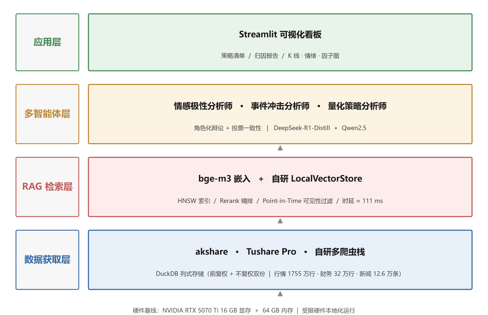
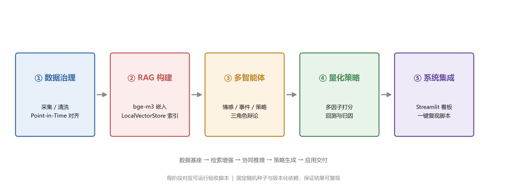
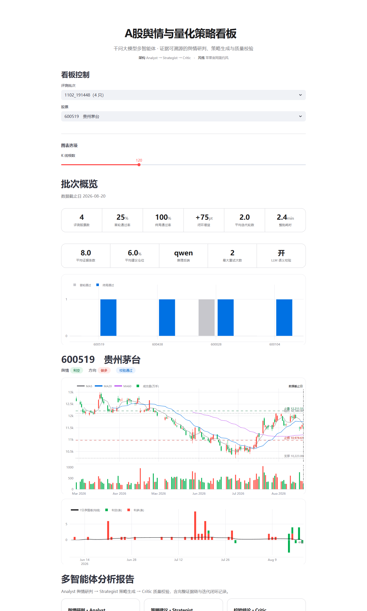
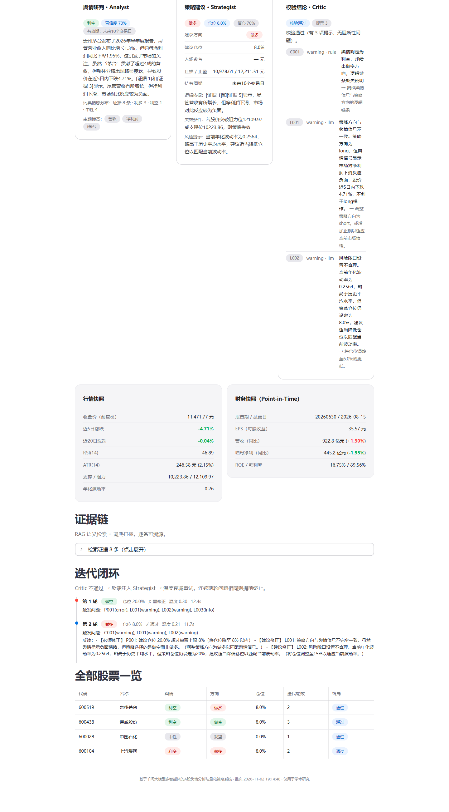

<div align="center">

# A 股多智能体舆情分析与量化策略系统

**基于千问大模型多智能体的 A 股舆情分析与量化策略系统设计与实现**

[](https://www.python.org/)
[](https://pytorch.org/)
[](https://duckdb.org/)
[](https://www.modelscope.cn/)
[](https://huggingface.co/BAAI/bge-m3)
[](https://www.nvidia.com/)
[](https://github.com/yellowanchor/a-share-agent-system)

</div>

---

## 项目简介

本系统面向 A 股市场，构建「数据采集 → 情感分析 → 检索增强 → 多智能体决策」的完整技术链路：以 1755 万行行情数据与 12.6 万条金融新闻为数据基座，通过弱监督打标与 QLoRA 微调训练金融领域情感分析模型（准确率 89.0%），并以自研向量库提供毫秒级证据检索，最终由分析师 / 策略师 / 评审员三类智能体协作生成可追溯的投资分析报告。

> 本科毕业设计项目 · 2026 届 · 数据科学与大数据技术

## 目录

- [核心特性](#核心特性)
- [系统架构](#系统架构)
- [快速开始](#快速开始)
- [项目结构](#项目结构)
- [实验结果](#实验结果)
- [技术栈](#技术栈)
- [开发路线](#开发路线)
- [免责声明](#免责声明)

## 核心特性

| 特性 | 说明 |
|------|------|
| **真实数据基座** | 全 A 股行情 1755 万行（5443 只，含退市 232 只，1990–2026）、财务报表 32 万行、金融新闻 12.6 万条，全部来自公开渠道，无任何模拟数据 |
| **Point-in-Time 对齐** | 财务数据按 `pubDate`（实际披露日）对齐，杜绝未来函数，保证回测有效性；行情同时保存前复权与不复权双份 |
| **自研向量库 LocalVectorStore** | 替代 ChromaDB，规避其在 Windows 下 HNSW 索引不落盘的缺陷；bge-m3 + GPU 精确余弦检索，端到端 111ms，支持 md5 幂等的增量更新 |
| **弱监督 + QLoRA 情感分析** | 金融情感词典（人工一致率 90.5%）自动打标 12.6 万条，再以 QLoRA NF4 微调 Qwen2.5-7B，准确率 89.0%，利空类召回率 100% |
| **16GB 显存工程方案** | 尾部 logits 切片 + 左填充，解决 Windows WDDM 显存换页问题，单卡完成 7B 模型 3 epoch 训练 |
| **三 Agent 协作与证据链** | Analyst（检索研判）→ Strategist（策略生成）→ Critic（双层校验），每个结论带 `[证据 n]` 编号可溯源至原文；Critic 采用「确定性规则 + 大模型语义」双层校验，规则层可复现 |

## 系统架构

<div align="center">
  
</div>

<details>
<summary>架构分层说明</summary>

- **数据层**：`data_platform` 负责采集（AkShare / BaoStock / 新浪财经 / 腾讯行情），产出 parquet 后由 DuckDB 统一建库；
- **存储层**：DuckDB 列式分析库（3555 万行，建库 27s）+ LocalVectorStore 向量索引（12.6 万条 × 1024 维）；
- **模型层**：bge-m3 嵌入模型 + Qwen2.5-7B-Instruct（QLoRA 微调）情感分类器；
- **智能体层**：Analyst（检索证据生成初稿）/ Strategist（策略建议）/ Critic（事实校验）；
- **应用层**：Streamlit 交互式看板。

</details>

### 工作流程

<div align="center">
  
</div>

## 快速开始

### 1. 环境准备

```bash
git clone https://github.com/yellowanchor/a-share-agent-system.git
cd a-share-agent-system/a_share_agent_system

# 以可编辑模式安装（推荐，安装后任意目录均可 import src.*）
pip install -e .[dev]

# PyTorch（CUDA 12.8）需单独安装，否则 pip 会拉取 CPU 版本
pip install torch --index-url https://download.pytorch.org/whl/cu128
```

> 未执行 `pip install -e .` 时，脚本内置 `sys.path` 兜底仍可正常运行。
> 常用命令也可用 `make db` / `make rag` / `make train` / `make eval` 调用。

模型权重需自行下载并放入 `models/` 目录（该目录已加入 `.gitignore`）：

| 模型 | 来源 |
|------|------|
| `BAAI/bge-m3` | Hugging Face / ModelScope |
| `Qwen/Qwen2.5-7B-Instruct` | ModelScope |

### 2. 数据底座构建

```bash
# 构建 DuckDB 行情库（1755 万行，约 27s）
python scripts/build_market_db.py

# 构建向量检索索引（12.6 万条新闻）
python scripts/build_rag_index.py

# 端到端验证（8 项验收）
python scripts/validate_rag.py
```

### 3. 情感分析（Phase 2）

```bash
# 弱监督词典打标（12.6 万条，7.9 秒）
python scripts/build_sentiment_dataset.py

# 构造 QLoRA 指令训练集（44,100 条，自动排除 Golden Set）
python scripts/build_sft_dataset.py

# 微调 Qwen2.5-7B（支持 --resume 断点续训）
python src/models/sentiment/train.py

# Golden Set 评估：base vs SFT
python src/models/sentiment/evaluate.py

# RAG 检索质量评估（Recall@5 / MRR@10）
python scripts/eval_rag_recall.py
```

### 4. 三 Agent 工作流（Phase 3.2 起由编排层驱动）

```bash
# 离线联调：不加载大模型，秒级验证流程与降级路径
python scripts/run_agent_demo.py --code 600519 --backend mock

# 真实推理：Qwen2.5-7B-Instruct 4bit + bge-m3，输出带证据链的 Markdown 报告
python scripts/run_agent_demo.py --code 600519 --backend qwen --as-of 2026-08-20

# 多股票批量评测（8 只跨行业，产出 Markdown 报告 + 结构化 JSON）
python scripts/batch_eval.py --backend qwen --as-of 2026-08-20

# 关闭迭代闭环做对照实验（等价于 Phase 3.1 的单向流水线）
python scripts/batch_eval.py --backend qwen --max-retries 0

# 单元测试（41 项：词典回归 / 指标解析解 / JSON 容错 / Critic 规则 / 编排闭环分支）
pytest tests/ -v
```

单次真实推理耗时参考（RTX 5070 Ti 16GB）：Analyst 44s（含 bge-m3 首次编码）、Strategist 4.5s、Critic 5.0s。
批量评测复用同一批 Agent 实例：首只承担模型加载（约 14 s），后续每只检索仅约 50 ms。

### 5. 前端看板（Phase 3.3）

```bash
# 苹果官网简约风格的 Streamlit 看板（纯只读展示层，不加载大模型）
streamlit run src/app/main.py
```

看板功能：

- **批次概览**：首轮/终局通过率、闭环增益、平均迭代轮数、整批耗时；首轮 vs 终局通过率对比图
- **K 线图**：前复权日线 + MA5/20/60 + 策略价位线（止损/止盈/入场/支撑/阻力）+ PIT 数据截止日竖线
- **情感趋势**：日频利多/利空条形（红涨绿跌）+ 7 日净情绪均线（词典打标，90.5% 一致率）
- **Agent 报告**：Analyst / Strategist / Critic 三卡片 + 行情/财务快照 + 证据链（逐条可溯源）+ 迭代闭环时间线

<div align="center">
  
</div>

<details>
<summary>更多截图</summary>

<div align="center">
  
</div>

</details>

## 项目结构

```
a-share-agent-system/
├── a_share_agent_system/              # 主系统（Python 包根目录）
│   ├── pyproject.toml                 # PEP 621 元数据 + ruff/pytest/mypy 配置
│   ├── Makefile                       # 常用命令入口（make db / rag / train / eval）
│   ├── src/                           # 源码（src-layout，安装后可全局 import）
│   │   ├── config.py                  # 统一配置与路径入口
│   │   ├── agents/                    # 多智能体（Analyst / Strategist / Critic）
│   │   │   ├── schemas.py             # Agent 间数据契约（Pydantic）
│   │   │   ├── analyst.py             # 舆情研判：RAG 检索 + 词典打标 + 证据编号
│   │   │   ├── strategist.py          # 策略生成：ATR 参考价位 + 方向约束 + 反馈重试
│   │   │   ├── critic.py              # 双层校验：13 项规则 + LLM 语义
│   │   │   ├── orchestrator.py        # 编排层：迭代闭环 + 批量执行 + 安全降级
│   │   │   ├── report.py              # Markdown 渲染（单只 + 批量，单一来源）
│   │   │   └── stats.py               # 批量评测指标统计
│   │   ├── data/
│   │   │   ├── storage/               # DuckDB 查询接口
│   │   │   └── _legacy/               # 早期采集框架（归档，已停用）
│   │   ├── models/
│   │   │   ├── llm/                   # LLM 后端（Qwen 4bit / Mock 离线桩）
│   │   │   ├── rag/                   # 自研向量库 LocalVectorStore（支持增量更新）
│   │   │   └── sentiment/             # 情感分析（词典打标 / QLoRA / 评估）
│   │   ├── app/                       # Streamlit 看板（Phase 3.3：main/style/data/charts/views 五模块）
│   │   │   ├── main.py                # 主入口（批次/股票选择、页面编排）
│   │   │   ├── style.py               # 苹果官网简约风 CSS
│   │   │   ├── data.py                # 只读数据访问层（DuckDB/JSON/Parquet + 缓存）
│   │   │   ├── charts.py              # Plotly K线/情感趋势/通过率图（红涨绿跌）
│   │   │   └── views.py               # Agent 报告 HTML 片段渲染
│   │   └── utils/                     # 日志 / 显存监控 / 技术指标 / JSON 容错
│   ├── scripts/                       # 构建、评估、验证脚本
│   │   └── _legacy/                   # 一次性验证脚本（归档）
│   ├── configs/                       # settings.yaml / train_config.yaml / prompts
│   ├── tests/                         # pytest 用例
│   ├── docs/                          # 架构图与流程图
│   └── reports/                       # 实验报告
├── data_platform/                     # 数据采集平台（Phase 1 实际采集器）
│   ├── scripts/                       # 采集脚本（01–06）
│   └── src/                           # BaoStock 客户端与存储封装
└── README.md
```

> 数据与模型权重不纳入版本控制，详见 [`.gitignore`](.gitignore)。

## 实验结果

### 数据底座性能（Phase 1）

| 指标 | 数值 |
|------|------|
| DuckDB 入库（3555 万行） | 27 秒 |
| 行情区间查询 | 56 ms |
| 向量检索端到端（12.6 万条） | 111 ms |
| Phase 1 验收项 | 8 / 8 通过 |

### 情感分析对比（Phase 2，Golden Set 200 条人工标注）

| 模型配置 | Accuracy | Macro-F1 |
|----------|:--------:|:--------:|
| 词典（弱监督教师） | 0.905 | — |
| **SFT（QLoRA 3 epoch）** | **0.890** | **0.858** |
| SFT + RAG（检索增强） | 0.820 | 0.733 |
| base（Qwen2.5-7B 零样本） | 0.795 | 0.750 |

**SFT 分类别指标**

| 类别 | Precision | Recall | F1 |
|------|:---------:|:------:|:--:|
| 利好 | 0.953 | 0.878 | 0.914 |
| 利空 | 0.914 | **1.000** | 0.955 |
| 中性 | 0.667 | 0.750 | 0.706 |

**关键结论**

1. **SFT 微调有效**：较 base 提升 9.5 个百分点，利空类 53/53 全部命中，对风控场景最具价值。
2. **弱监督天花板效应**：SFT 误差与教师词典重合度达 94.7%，逼近但未超越 90.5%，符合弱监督学习理论预期；突破需引入更高质量标注源。
3. **RAG 对单条分类无增益（负结果）**：检索增强使准确率降至 82.0%，归因于训练/推理分布偏移与历史新闻的错误锚定。因此 RAG 的定位调整为**报告生成的证据引用**，而非分类器增益。

### RAG 检索质量

| 指标 | 数值 |
|------|------|
| Recall@5 | 0.842 |
| MRR@10 | 0.809 |
| 单次向量检索 | 3 ms |
| 首个相关结果落位 Top-1 | 78.6% |

### 三 Agent 工作流（Phase 3.1，贵州茅台 600519 / 截止日 2026-08-20）

| 阶段 | 输出 | 耗时 |
|------|------|------|
| Analyst | 检索 8 条证据（半年报相关），判定**利空**（置信 0.70），引用 [证据 2][证据 5] | 44.2 s |
| Strategist | 方向**做空**，仓位 20%，止损 11964.93 / 止盈 10732.03 | 4.5 s |
| Critic | 13 项规则 + LLM 语义校验，**通过**（0 阻断 / 1 提示） | 5.0 s |

### 多股票批量评测（Phase 3.2，8 只跨行业 / Qwen 4bit / 截止日 2026-08-20）

| 指标 | 数值 |
|------|------|
| 首轮通过率 | 100%（8/8，提示词改进后策略质量稳定） |
| 方向分布 | 做空 2（茅台 / 通威）/ 做多 4 / 观望 2 |
| 整批耗时 | 2m29s（首只 14.3s 含模型加载，稳态单只 9–12s） |

### 迭代闭环收敛实验（生成侧仓位上限 20% vs 校验侧 8%）

| 指标 | 数值 |
|------|------|
| 首轮通过率 | 25% |
| 终局通过率 | **100%**（闭环收敛增益 **+75%**） |
| 平均迭代轮次 | 2.0 |
| 终局分布 | 重试通过 2 / 采纳自动修正 1 / 首轮通过 1 |

实测发现（可直接写入论文）：反馈重试能修掉指定问题，但模型可能**连带
改变原本正确的字段**（重试轮把做空改成做多）；且重试输出不单调收敛。
结论：**确定性自动修正作为兜底不可少**，纯靠模型重试不可靠。

**Critic 校验规则表**（规则层确定性可复现，不依赖模型）

| 编号 | 校验内容 | 编号 | 校验内容 |
|------|----------|------|----------|
| E001 | 证据编号越界 | N001 | 缺止损/止盈 |
| E002 | 无证据引用 | N002 | 止损方向错误 |
| E003 | 引用与声明不一致 | N003 | 止盈方向错误 |
| P001 | 仓位超 20% 上限 | N004 | 报价偏离现价（疑似幻觉） |
| P002 | 仓位数值非法 | T001 | 缺失效条件 |
| C001 | 方向与舆情矛盾 | T002 | 缺持有周期 |
| C002 | 观望却有仓位 | L001 | 大模型语义校验（仅供参考） |

**实测发现（可直接写入论文）**

1. **大模型不可靠性**：首次真实推理中，模型照抄了「现价 − 2×ATR」这一做多口径参考价，却在结论里选了做空方向，导致止损/止盈方向完全相反 —— 被 Critic 的 N002/N003 确定性拦截。修复方式是把参考价位拆成做多/做空两套并与方向绑定。
2. **语义层自身也会出错**：LLM 校验曾给出「把做空止损调到低于收盘价」的建议，该建议本身是错的。因此设计中把语义校验结论标注为**仅供参考**，判定权完全交给规则层与人工。

## 技术栈

| 类别 | 技术 |
|------|------|
| 语言 | Python 3.12.3 |
| 数据存储 | DuckDB 1.5.3（列式，内存模式） |
| 向量检索 | 自研 LocalVectorStore（bge-m3 + torch GPU 精确余弦） |
| 嵌入模型 | BAAI/bge-m3（1024 维，560M 参数） |
| 千问大模型 | Qwen2.5-7B-Instruct（QLoRA NF4 + LoRA r=64） |
| 训练框架 | PyTorch 2.11.0+cu128 / PEFT / TRL / bitsandbytes |
| 数据源 | AkShare / BaoStock / 新浪财经 / 腾讯行情 |
| 前端 | Streamlit 1.52（苹果官网简约风格）+ Plotly 5.24 |

## 开发路线

- [x] **Phase 1** — 数据底座：数据采集 + DuckDB 建库 + RAG 向量检索
- [x] **Phase 2** — 模型训练：弱监督打标 + QLoRA 微调 + 三组对比实验
- [x] **工程化重构** — pyproject 包化 / 死代码归档 / 统一配置入口
- [x] **Phase 3.1** — 三 Agent 实现（Analyst / Strategist / Critic）+ 证据链 + 双层校验 + 28 项测试
- [x] **Phase 3.2** — 编排层：Critic 反馈迭代闭环（4 种终局 + 提前终止）、多股票批量评测（首/终局通过率、规则触发频次）、41 项测试
- [x] **Phase 3.3** — Streamlit 前端看板（苹果官网简约风格）：批次概览 / K 线 + 策略价位线 / 情感趋势 / 三 Agent 报告 + 证据链 + 迭代闭环时间线

## 硬件环境

| 项 | 配置 |
|----|------|
| GPU | NVIDIA RTX 5070 Ti 16GB（Blackwell, sm_120） |
| 内存 | 64GB（计划调整为 32GB，瓶颈在显存，影响有限） |
| 操作系统 | Windows 11 |

## 免责声明

本项目为学术研究用途，所有结论不构成任何投资建议。数据来源为公开渠道（AkShare、BaoStock、新浪财经、腾讯行情等），模型输出存在不确定性，请勿直接用于实际投资决策。
